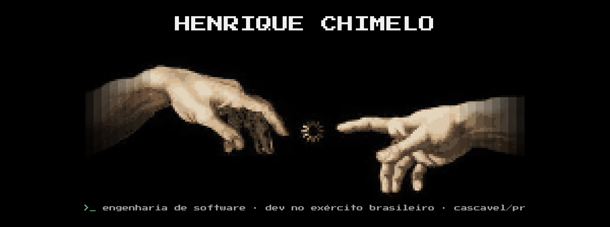

##  >_ Olá, eu sou o Henrique

Desenvolvo sistemas internos que resolvem problemas reais do dia a dia, do banco de dados à interface.

## >_ Sobre mim

* 🎓 **Acadêmico de Engenharia de Software** — Centro Universitário da Fundação Assis Gurgacz (FAG)
* 🪖 **Desenvolvedor no Exército Brasileiro** — sistemas internos de gestão e auditoria
* 📍 **Cascavel – PR**

## 🛠️ >_ Tecnologias

  

## 📊 >_ Estatísticas & Social

  

  

